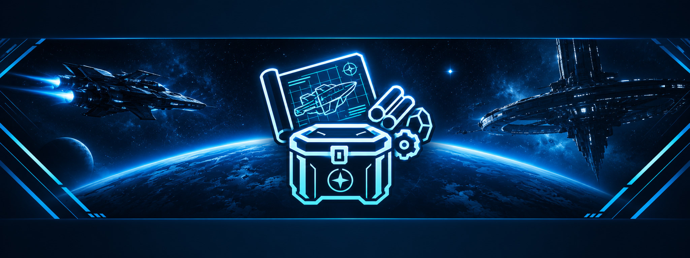

<p align="center"></p>

<h1 align="center">Quartermaster</h1>

<p align="center">
  Your Star Citizen materials, ship components, FPS gear, refinery orders and blueprints, kept in one place.
</p>

<p align="center">
  
  
  <a href="LICENSE"></a>
</p>

Quartermaster keeps track of what you own in Star Citizen: what you mined and refined, the components and gear in your
hangars, the refinery orders still running and the blueprints you have unlocked. The **Companion** reads most of it
straight from the game, so there is little to type.

### Latest Downloads

<div id="release_dls">

| | Windows | Linux |
| --- | --- | --- |
| **Quartermaster (singleuser)** | **[Installer](https://github.com/w00zla/quartermaster/releases/download/app-v1.1.0/Quartermaster_1.1.0_x64-setup.exe)** | **[AppImage](https://github.com/w00zla/quartermaster/releases/download/app-v1.1.0/Quartermaster_1.1.0_amd64.AppImage)** |
| **Quartermaster Companion** | **[Installer](https://github.com/w00zla/quartermaster/releases/download/companion-v2.1.0/Quartermaster-Companion_2.1.0_x64-setup.exe)** · [Standalone](https://github.com/w00zla/quartermaster/releases/download/companion-v2.1.0/Quartermaster-Companion_2.1.0_x64-standalone.zip) | **[AppImage](https://github.com/w00zla/quartermaster/releases/download/companion-v2.1.0/Quartermaster-Companion_2.1.0_amd64.AppImage)** · [deb](https://github.com/w00zla/quartermaster/releases/download/companion-v2.1.0/Quartermaster-Companion_2.1.0_amd64.deb) · [rpm](https://github.com/w00zla/quartermaster/releases/download/companion-v2.1.0/Quartermaster-Companion-2.1.0-1.x86_64.rpm) |

</div>

All versions, test channels included: [releases](https://github.com/w00zla/quartermaster/releases).

# Two ways to use it

- **Quartermaster (singleuser)**, the app on your PC, for one player: no server, no Discord, no account. It brings the
  game data (catalog and item pictures) with it and keeps it current by itself. More: [docs/app.md](docs/app.md).
- **Quartermaster (hosted)**, the service for orgs: a Discord bot and a web app on one server. One Discord server is
  one org; each player's stock is their own and is shared into orgs batch by batch. The bot has slash commands, an org
  board that updates itself and a logs channel, in German and English; the web app shows the same data in the
  browser, signed in with Discord. How it is run: [docs/deploy.md](docs/deploy.md).

The Companion works with either: it talks to the app on the same PC, or to the web app of Quartermaster (hosted) with
an API token.

# Features

- **Stock:** materials with their quality, ship components and FPS gear with their stats, each batch where it is.
- **Refinery orders:** what is refining where, and when it is done.
- **Blueprints and crafting:** your blueprint collection, and a check of what you can craft from your stock.
- **Prices:** trade prices from [UEX](https://uexcorp.space). In the app this is optional and uses your own UEX key.
- **Your language:** with the game folder set, the app shows the game's texts in the language pack you play with.

# Companion

The Companion (`companion/`) reads what the game shows and turns it into stock, blueprint and refinery entries:

- **Blueprints** from the game's `Game.log`: every unlock as it happens, and the history from old logs.
- **Scans** while you play: the freight manager's warehouse (materials with quality and amount), the character
  inventory (ship components and FPS gear with their stats) and the refinery terminal (work orders), read with OCR
  from the game window. Each read is a proposal you confirm.
- **Overlay:** what a scan sees, drawn over the game without catching your clicks.

Scans and the overlay need Windows 10 or 11; on Linux the Companion reads `Game.log` only. On Windows it also comes
as a standalone zip without installer: unpack it anywhere and start `quartermaster-companion.exe`; it tells you about
a new version but does not update itself. How it works: [docs/companion.md](docs/companion.md).

# Updates

Both apps and the app's game data update themselves; after the first install nothing needs installing by hand. They
ask GitHub only, without a login and without sending anything about you: `channels.json` from
`raw.githubusercontent.com/w00zla/quartermaster/channels`, then the files of the release it names. An app update is
checked against the maintainer's signature before it is installed.

To switch it off: "Automatic updates" ("Automatische Updates") in the app's settings, which covers the app and its
game data, and the Companion's own switch in its settings. A Companion from before it could update itself needs one
manual install from the downloads above.

# Building

Requirements: Node 26+ and pnpm; PostgreSQL 18 for Quartermaster (hosted); Rust and the
[Tauri 2 prerequisites](https://tauri.app/start/prerequisites/) for the two desktop apps. The Companion's OCR comes
from [sc-ohseearr](https://github.com/w00zla/sc-ohseearr), fetched by its release tag.

```sh
pnpm install
pnpm typecheck && pnpm test   # backend checks (DB tests need TEST_DATABASE_URL)
pnpm webapp:dev               # the web app on Vite (needs the backend: pnpm webapp)
pnpm app:start                # Quartermaster (singleuser) in development
pnpm app:build                # Quartermaster (singleuser), release build for this OS
pnpm companion:directml       # once on Windows: DirectML.dll for the GPU OCR
pnpm companion:start          # the Companion in development
pnpm companion:build          # the Companion, release build for this OS
```

`.env.example` lists the settings. `CLAUDE.md` has all commands, the conventions and a map of what is described where;
the details are in [docs/](docs). Releasing: [docs/releasing.md](docs/releasing.md).

# Related projects

- [sc-ohseearr](https://github.com/w00zla/sc-ohseearr): OCR engine, models and screen readers for Star Citizen
- [sc-packshot](https://github.com/w00zla/sc-packshot): renders the item pictures
- [starbreaker-ps](https://github.com/w00zla/starbreaker-ps): the StarBreaker fork that reads the game data

# Credits

- [StarBreaker](https://github.com/diogotr7/StarBreaker) by diogotr7, used through our fork to read the game data.
- [UEX](https://uexcorp.space) for prices.

# Game data and fan content

Quartermaster and its Companion are an unofficial Star Citizen fan project, not endorsed by or affiliated with the
Cloud Imperium group of companies. Game content and materials are copyright Cloud Imperium Rights LLC and Cloud
Imperium Rights Ltd. Star Citizen® is a registered trademark of Cloud Imperium Rights LLC.

# License

[MIT](LICENSE). Bundled third-party parts keep their own licenses.
