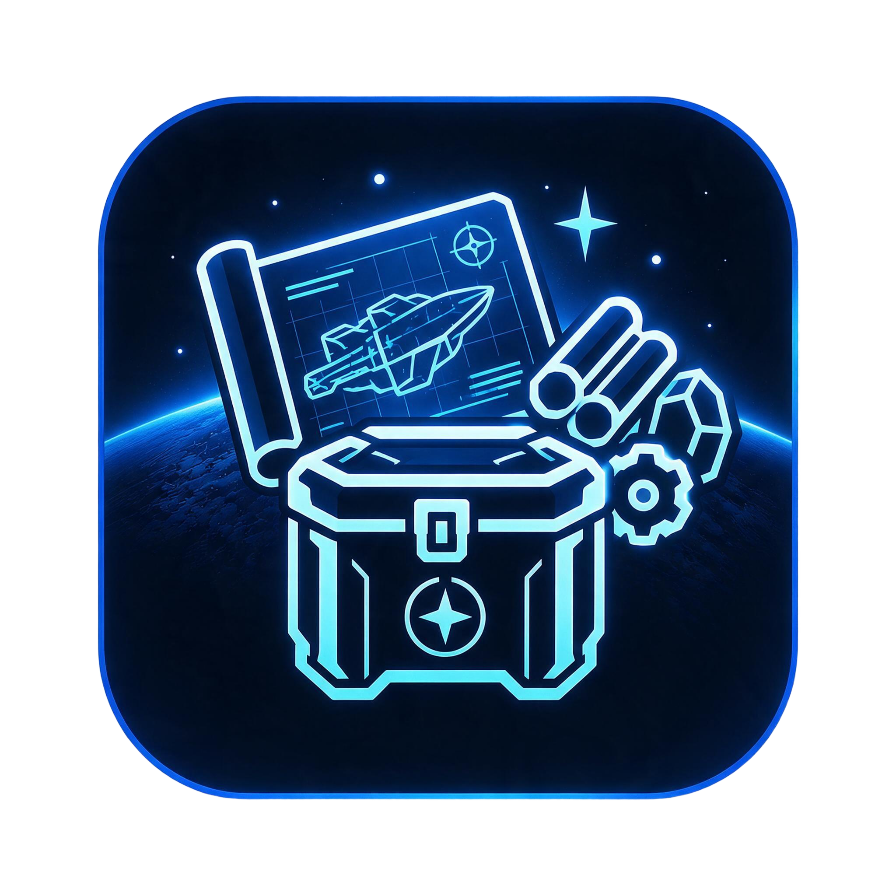

# Quartermaster

Quartermaster is a Discord bot, a user web app and an admin web UI for Star Citizen players and orgs to manage materials
(stock), ship components, refinery jobs and blueprints. One Discord server is one org; German and English. It also serves
the API of the companion desktop app.

Sibling repositories:

- [QuarterMasterCompanion](https://github.com/w00zla/QuarterMasterCompanion) (local checkout `../sc-qm-companion`): the companion desktop app (Game.log, scans, overlay)
- [sc-ohseearr](https://github.com/w00zla/sc-ohseearr): OCR engine, models and training
- [sc-packshot](https://github.com/w00zla/sc-packshot): the item icon renderer
- [starbreaker-ps](https://github.com/w00zla/starbreaker-ps): the StarBreaker fork used to read the game data

## Documentation

`CLAUDE.md` lists the commands, conventions and the table of what is described where; the details are in `docs/`
(requirements, catalog sources, stock, bot, web app, admin app, third-party data, deployment).

## Game data and fan content

Quartermaster is an unofficial Star Citizen fan project, not endorsed by or affiliated with the Cloud Imperium group of
companies. Game content and materials are copyright Cloud Imperium Rights LLC and Cloud Imperium Rights Ltd. Star Citizen®
is a registered trademark of Cloud Imperium Rights LLC.
