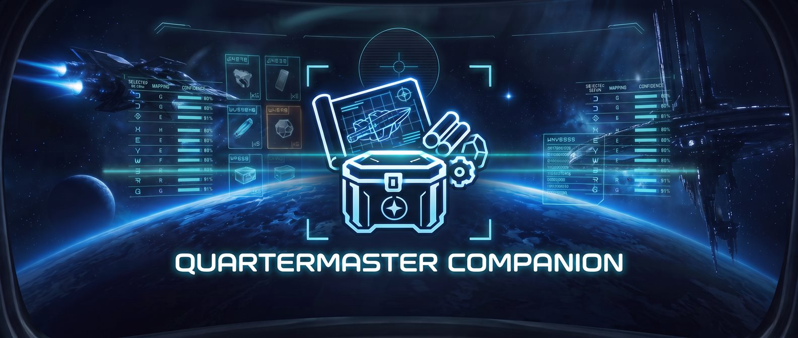

<p align="center"></p>

# Quartermaster Companion

A desktop companion for Star Citizen and the [Quartermaster](https://github.com/w00zla/QuarterMaster) web app: it
reads what the game shows and turns it into stock, blueprint and refinery entries, without typing.

- **Blueprints** from the game's `Game.log`: every unlock as it happens, and the history from old logs.
- **Scans** while you play (Windows): the freight manager's warehouse (materials with quality and amount), the
  character inventory (ship components and FPS gear with their stats) and the refinery terminal (work orders), read
  with OCR from the game window. Each read becomes a proposal you confirm in the app.
- **Overlay**: what the scan sees, drawn click-through over the game.
- German and English; follows the game's language pack.

The OCR, the readers, the game's language tables and the window capture come from
[sc-ohseearr](https://github.com/w00zla/sc-ohseearr), a separate repository for OCR of Star Citizen screens (engine,
models, readers, training).

## Requirements

- Windows 10/11 for the scans and the overlay (DXGI capture); Linux builds read `Game.log` only.
- A Quartermaster account and an API token from its web app (Companion dialog).
- For the refinery scan: a language pack, or the game's English texts as `global-english.ini` in the app's data folder.

## Build

The Rust side uses [sc-ohseearr](https://github.com/w00zla/sc-ohseearr) as path dependencies, so clone both side by side:

```sh
git clone https://github.com/w00zla/sc-ohseearr
git clone https://github.com/w00zla/QuarterMasterCompanion
cd QuarterMasterCompanion
pnpm install
pnpm directml            # once on Windows: DirectML.dll for the GPU OCR
pnpm companion:start     # develop (tauri dev)
pnpm companion:build     # release build for this OS
```

Tests: `pnpm typecheck`, `pnpm test`, `cargo test --release --manifest-path src-tauri/Cargo.toml`.
Everything about how it works: [docs/companion.md](docs/companion.md).

## Game data and fan content

Quartermaster Companion is an unofficial Star Citizen fan project, not endorsed by or affiliated with the Cloud Imperium group of companies. Game content and materials are copyright Cloud Imperium Rights LLC and Cloud Imperium Rights Ltd. Star Citizen® is a registered trademark of Cloud Imperium Rights LLC.

## License

Not decided yet; all rights reserved until then. Bundled third-party parts keep their licenses (fonts in
`src/assets/fonts` under the OFL; DirectML.dll is Microsoft's redistributable, MIT).
